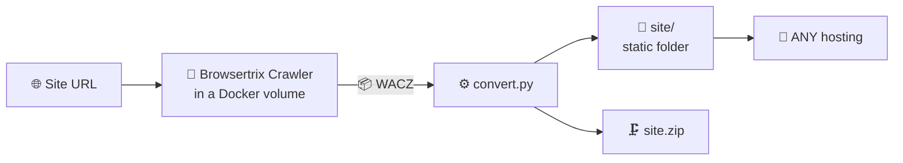

<div align="center">

# ◧ site-copier

**Copies any Framer website into a static folder — ready to deploy on any hosting**


[🇷🇺 Русский](README.md) · **🇬🇧 English** · [🇨🇳 中文](README.zh.md)

</div>

---

## 📸 Screenshots

<details open>
<summary><b>Control panel</b> — new-job form and job list</summary>
<br>

</details>

<details open>
<summary><b>Finished jobs</b> — statuses, stats, ZIP and preview buttons</summary>
<br>

</details>

<details open>
<summary><b>The result</b> — a copied site (precept.framer.website, 33 pages) running fully offline</summary>
<br>

<br><br>

</details>

## ✨ Features

| | |
|---|---|
| 🌐 **Any Framer site** | paste a URL — get a folder with a working site |
| 🧹 **Clean copy** | Framer editor panels and promo badges ("Made in Framer", "Buy template", "Remix", "from $99") are stripped out |
| 🔌 **Fully offline** | zero external requests, all assets served locally |
| 🖱 **Alive copy** | Framer hydration and animations keep working — no blank screens |
| 📦 **One-click ZIP** | ready-to-upload folder for any hosting |
| 👀 **Built-in preview** | every copy opens in a browser straight from the panel |
| 💾 **Survives a full disk** | crawling runs inside a Docker volume, bypassing the 99% disk-usage gate |

## 🚀 Quick start

```bash
# 1. Docker (on macOS: OrbStack — lighter and faster than Docker Desktop)
brew install orbstack && open -a OrbStack
# Linux: sudo apt install docker.io

# 2. Project
git clone https://github.com/robofighter/site-copier.git
cd site-copier

# 3. Browsertrix crawler image — REQUIRED (details in the section below)
docker pull webrecorder/browsertrix-crawler:1.15.0

# 4. Start the panel (default port 8200; custom: PORT=9000)
python3 server.py

# 5. Open in your browser → http://127.0.0.1:8200
```

Everything else happens in the panel: **URL → "Copy site" → wait for "done" → "Open" / "Download ZIP"**.

> **Why the image is a required step.** It's not an add-on — it **is** the
> crawler: without it the system physically cannot work, jobs fail with
> "Failed to download the image". The panel will try to pull the image
> automatically on the first job (the status badge shows "image not downloaded"
> if that fails), but pulling it up front saves the first job from waiting for
> a gigabyte download.

## 🐳 Browsertrix crawler image — the key dependency

**What it is.** `webrecorder/browsertrix-crawler:1.15.0` is the official
container of the [Browsertrix](https://github.com/webrecorder/browsertrix)
project (Webrecorder): it bundles Chromium and the crawler that walks the site
**in a real browser**. It runs on every job (`crawler.py` → `docker run`), so
Docker is not optional — it's a hard requirement.

| Parameter | Value |
|---|---|
| Image | `webrecorder/browsertrix-crawler:1.15.0` |
| Size (compressed) | ~1.03 GB (on disk with layers ~3.6 GB) |
| Architecture | arm64 (Apple Silicon) / amd64 — Docker picks the right one |
| Purpose | walking the site in a browser + recording WACZ |
| Without it | jobs fail with "Failed to download the image", panel shows "image not downloaded" |

<details open>
<summary><b>Download the image</b></summary>

```bash
docker pull webrecorder/browsertrix-crawler:1.15.0
```

Verify it's present:

```bash
docker images webrecorder/browsertrix-crawler
# or in detail:
docker image inspect webrecorder/browsertrix-crawler:1.15.0
```

The panel checks the image itself too — the badge in the top-right corner
("Docker ready" / "image not downloaded") and `GET /api/status`.
</details>

<details>
<summary><b>Automatic download</b></summary>

If the image is missing when a job starts, `crawler.py` runs `docker pull`
itself and carries on. Convenient, but the first start will take as long as the
download — so a manual `docker pull` up front is recommended.
</details>

<details>
<summary><b>Offline / another machine: save and load the image as an archive</b></summary>

```bash
# save to a file (on a machine with internet)
docker save webrecorder/browsertrix-crawler:1.15.0 | gzip > browsertrix-crawler.tar.gz

# load from the file (on a machine without internet)
gunzip -c browsertrix-crawler.tar.gz | docker load
```
</details>

<details>
<summary><b>If docker pull fails</b></summary>

- Check that Docker is running (`docker info`) and the internet is reachable.
- Behind a corporate proxy, set `HTTP_PROXY`/`HTTPS_PROXY` for the Docker
  daemon (in OrbStack / Docker Desktop settings).
- Free up space: ~4 GB needed on disk.
- Alternative — carry the image archive over from another machine (see above).
</details>

<details>
<summary><b>Deploying on a server / VPS</b></summary>

```bash
# on a Linux server
sudo apt update && sudo apt install -y docker.io python3
sudo usermod -aG docker $USER && newgrp docker
git clone https://github.com/robofighter/site-copier.git && cd site-copier
docker pull webrecorder/browsertrix-crawler:1.15.0   # crawler image — required
PORT=8200 nohup python3 server.py > panel.log 2>&1 &
# panel available at http://<server-ip>:8200
```
</details>

<details>
<summary><b>Git: updating the project to the latest version</b></summary>

```bash
cd site-copier
git pull                 # fetch updates from GitHub
docker pull webrecorder/browsertrix-crawler:1.15.0   # if the image tag changed
```

The `jobs/`, `previews/`, `crawls/` folders are not tracked in git (see
`.gitignore`) — `git pull` won't touch your jobs and copied sites.
</details>

## 🧩 How it works



1. **Crawl** (`crawler.py`) — Browsertrix walks the site in a real browser and produces a WACZ.
2. **Convert** (`convert.py`) — the WACZ becomes a folder: URLs are rewritten to local
   paths, a `new URL()` shim is injected into pages (without it Framer hydration fails
   and the site stays blank), Framer editor panels are cut out, and promo badges are
   removed by a MutationObserver right after hydration.
3. **Done** — upload `site/` to any hosting as-is, plus a ZIP for download.

## 🖥 Web panel

- **New site** — URL, crawl scope (host / prefix / domain / page), page limit,
  parallel browsers, time limit, behaviors, custom CSS hide-selectors
- **Jobs** — statuses and stages `queued → crawl → convert → done`, live log
- **Preview** — each copy is served by its own mini-server, exactly like a real
  deployment (root-absolute `/assets/...` paths work correctly)
- **Download ZIP** · **Rescan** — re-reads `jobs/` from disk without restarting the panel

## 📦 Dependencies

| What | Why | Required |
|---|---|---|
| **Docker** (OrbStack / Docker Desktop / docker-ce) | Run the crawler in a container | ✅ |
| **Image `webrecorder/browsertrix-crawler:1.15.0`** | **The crawler itself** — jobs don't work without it ([details](#-browsertrix-crawler-image--the-key-dependency)) | ✅ |
| **Python 3.8+** | Panel and converter | ✅ |
| pip packages | **none needed** — the whole codebase uses only the standard library | — |
| Node.js + Playwright | only for automated browser checks of copies (external scripts) | ⬜ optional |

<details>
<summary><b>Environment variables</b></summary>

- `PORT` — panel port (default `8200`)
- `BTRIX_IMAGE` — crawler image tag (default `webrecorder/browsertrix-crawler:1.15.0`)
</details>

## 🗂 Project structure

```
site-copier/
├── server.py      # web panel: jobs, statuses, ZIP, preview, API
├── crawler.py     # Browsertrix Crawler wrapper in Docker (crawls into a volume)
├── convert.py     # WACZ → static folder (URL rewriting, cleanup)
├── warcutil.py    # WACZ/WARC parsing, record extraction
├── static/        # panel UI (index.html, app.js, style.css)
├── docs/          # screenshots
└── jobs/          # job artifacts (not tracked in git)
```

## 🔌 API

<details>
<summary><b>Panel endpoints</b></summary>

| Method | Path | Purpose |
|---|---|---|
| GET | `/api/status` | Docker and image status |
| GET | `/api/jobs` | list jobs |
| POST | `/api/jobs` | create a job (`{url, scope, limit, workers, timeLimit, behaviors, hideSelectors}`) |
| GET | `/api/jobs/<id>` | job details + log |
| GET | `/api/jobs/<id>/download` | download `site.zip` |
| GET | `/api/jobs/<id>/open` | preview URL |
| GET | `/api/jobs/<id>/preview/<path>` | serve a file from the copy (with correct MIME) |
| POST | `/api/jobs/rescan` | re-read `jobs/` from disk |
</details>

## 🐛 Known pitfalls

<details>
<summary><b>"Out of disk space" when the crawl starts</b></summary>

Not about free gigabytes — about **percentage**: Browsertrix has a hard-coded gate
`usedPercentage >= 99`. On a host filled to 99%, the crawl dies within seconds even
with 15+ GB free. The fix is built in: crawling runs in a named Docker volume
(the OrbStack VM disk is ~22% used), then results are copied back. If the volume
can't be created, `crawler.py` gracefully falls back to the job directory.
</details>

<details>
<summary><b>"Buy Now" promo badge inside a full-width module</b></summary>

Some templates inject the purchase widget as a `data-framer-name="Buy Template
Module"` spanning the full page width, while the visible button inside has a neutral
name (`Button Wrapper`). A plain size guard used to let those through — the badge
sweeper now also inspects module content for promo markers (`Buy Now`, `from $99`,
checkout links) and hides the whole module.
</details>

<details>
<summary><b>HTTP_PROXY / HTTPS_PROXY environment variables</b></summary>

They break manual checks via `curl` (502) and browsers (`ERR_PROXY_CONNECTION_FAILED`).
Not critical for the panel; for manual checks use `curl --noproxy '*'` and
`--no-proxy-server` in the browser.
</details>

## ✅ Verified on

| Site | Pages | Done | Hydr. | Images | Ext. | 404 | Errors | Promo |
|---|---|---|---|---|---|---|---|---|
| `precept.framer.website` | 33 | ✅ | Y | 25/25 | 0 | 0 | 0 | 0 |
| `kyma.framer.ai` | 27 | ✅ | Y | 31/31 | 0 | 0 | 0 | 0 |
| `oberon.framer.website` | 8 | ✅ | Y | 36/37 | 0 | 0 | 0 | 0 |

"Hydr." — Framer hydration completed (the key sign of "not a blank screen");
"Ext." — requests to third-party servers; "Promo" — Framer badges, including
template purchase buttons.

## 📣 Promotion

**GitHub topics** — already set on the repo, that's how people discover it via GitHub search:

`framer` · `framer-website` · `framer-template` · `website-copier` · `site-downloader` · `website-cloner` · `web-archiving` · `browsertrix` · `webrecorder` · `static-site` · `docker` · `python` · `web-crawler` · `web-scraping` · `self-hosted` · `site-backup` · `web-archive` · `offline-first`

**Hashtags for posts** (X/Twitter, Reddit, etc.):

```
#framer #framerwebsite #webdev #python #docker #opensource
#webarchiving #staticwebsite #selfhosted #websitecopier
```

<div align="center">

**Panel · ZIP · self-contained copy — all local, no subscriptions**

</div>
