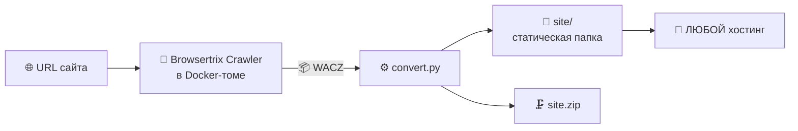

<div align="center">

# ◧ site-copier

**Копирует любой сайт на Framer в статическую папку — готовую к заливке на любой хостинг**


**🇷🇺 Русский** · [🇬🇧 English](README.en.md) · [🇨🇳 中文](README.zh.md)

</div>

---

## 📸 Скриншоты

<details open>
<summary><b>Веб-панель управления</b> — форма нового задания и список заданий</summary>
<br>

</details>

<details open>
<summary><b>Готовые задания</b> — статусы, статистика, кнопки ZIP и предпросмотра</summary>
<br>

</details>

<details open>
<summary><b>Результат</b> — скопированный сайт precept.framer.website (33 страницы) открывается локально</summary>
<br>

<br><br>

</details>

## ✨ Возможности

| | |
|---|---|
| 🌐 **Любой Framer-сайт** | вставляете URL — получаете папку с рабочим сайтом |
| 🧹 **Чистая копия** | панели редактора Framer и промо-бейджи («Made in Framer», «Buy template», «Remix», «from $99») вырезаны |
| 🔌 **Полностью автономно** | ноль внешних запросов, все ассеты локальные |
| 🖱 **Живая копия** | Framer-гидратация и анимации работают, ничего не белеет |
| 📦 **ZIP в один клик** | готовая папка для заливки на хостинг |
| 👀 **Встроенный предпросмотр** | каждый клон открывается в браузере прямо из панели |
| 💾 **Не падает на заполненном диске** | краулинг идёт в том Docker, обходя порог 99% занятого места |

## 🚀 Быстрый старт

```bash
# 1. Docker (macOS: OrbStack — быстрее и легче Docker Desktop)
brew install orbstack && open -a OrbStack
# Linux: sudo apt install docker.io

# 2. Проект
git clone https://github.com/robofighter/site-copier.git
cd site-copier

# 3. Образ краулера Browsertrix — ОБЯЗАТЕЛЬНО (подробнее в разделе ниже)
docker pull webrecorder/browsertrix-crawler:1.15.0

# 4. Панель (порт по умолчанию 8200, можно свой: PORT=9000)
python3 server.py

# 5. Открыть в браузере → http://127.0.0.1:8200
```

Дальше всё через панель: **URL → «Скопировать сайт» → дождаться «готово» → «Открыть» / «Скачать ZIP»**.

> **Почему образ — обязательный шаг.** Это не вспомогательный софт, а **сам
> краулер**: без него система физически не может работать — задания падают с
> ошибкой «Не удалось скачать образ». Панель попробует скачать образ
> автоматически при первом задании (индикатор покажет «образ не скачан», если
> не выйдет), но лучше скачать сразу, чтобы первое задание не ждало загрузку
> гигабайта.

## 🐳 Образ краулера Browsertrix — главная зависимость

**Что это.** `webrecorder/browsertrix-crawler:1.15.0` — официальный контейнер
проекта [Browsertrix](https://github.com/webrecorder/browsertrix) (Webrecorder):
внутри — Chromium и краулер, который обходит сайт **в реальном браузере**.
Именно он запускается на каждом задании (`crawler.py` → `docker run`), поэтому
Docker — не опция, а необходимость.

| Параметр | Значение |
|---|---|
| Образ | `webrecorder/browsertrix-crawler:1.15.0` |
| Размер (сжатый) | ~1.03 ГБ (на диске со слоями ~3.6 ГБ) |
| Архитектура | arm64 (Apple Silicon) / amd64 — Docker сам выберет нужную |
| Зачем | обход сайта в браузере + запись WACZ |
| Без него | задания падают с «Не удалось скачать образ», панель показывает «образ не скачан» |

<details open>
<summary><b>Скачать образ</b></summary>

```bash
docker pull webrecorder/browsertrix-crawler:1.15.0
```

Проверить, что образ на месте:

```bash
docker images webrecorder/browsertrix-crawler
# или детально:
docker image inspect webrecorder/browsertrix-crawler:1.15.0
```

Панель тоже проверяет образ сама — индикатор в правом верхнем углу
(«Docker готов» / «образ не скачан») и `GET /api/status`.
</details>

<details>
<summary><b>Автоматическая загрузка</b></summary>

Если образ не найден при запуске задания, `crawler.py` сам выполнит
`docker pull` и продолжит работу. Удобно, но первый старт замедлится на время
загрузки — поэтому ручной `docker pull` заранее рекомендуется.
</details>

<details>
<summary><b>Офлайн / другой компьютер: сохранить и загрузить образ архивом</b></summary>

```bash
# сохранить в файл (на машине с интернетом)
docker save webrecorder/browsertrix-crawler:1.15.0 | gzip > browsertrix-crawler.tar.gz

# загрузить из файла (на машине без интернета)
gunzip -c browsertrix-crawler.tar.gz | docker load
```
</details>

<details>
<summary><b>Если docker pull падает</b></summary>

- Проверьте, что Docker запущен (`docker info`) и есть интернет.
- При корпоративном прокси настройте `HTTP_PROXY`/`HTTPS_PROXY` для демона
  Docker (в настройках OrbStack / Docker Desktop).
- Освободите место: на диске должно быть ~4 ГБ.
- Альтернатива — перенос архива образа с другого компьютера (см. выше).
</details>

<details>
<summary><b>Развёртывание на сервере / VPS</b></summary>

```bash
# на сервере с Linux
sudo apt update && sudo apt install -y docker.io python3
sudo usermod -aG docker $USER && newgrp docker
git clone https://github.com/robofighter/site-copier.git && cd site-copier
docker pull webrecorder/browsertrix-crawler:1.15.0   # образ краулера — обязательно
PORT=8200 nohup python3 server.py > panel.log 2>&1 &
# панель доступна на http://<ip-сервера>:8200
```
</details>

<details>
<summary><b>Git: обновление проекта до последней версии</b></summary>

```bash
cd site-copier
git pull                 # забрать обновления с GitHub
docker pull webrecorder/browsertrix-crawler:1.15.0   # если обновился тег образа
```

Папки `jobs/`, `previews/`, `crawls/` в git не идут (см. `.gitignore`) — при
`git pull` ваши задания и копии сайтов не затрагиваются.
</details>

## 🧩 Как это работает



1. **Краулинг** (`crawler.py`) — Browsertrix обходит сайт в браузере и складывает WACZ.
2. **Конвертация** (`convert.py`) — WACZ превращается в папку: URL переписываются в
   локальные, в страницы внедряется шим `new URL()` (без него Framer-гидрация падает
   и сайт остаётся белым), вырезаются панели Framer, промо-бейджи удаляются
   MutationObserver'ом уже после гидрации.
3. **Готово** — `site/` заливается на хостинг как есть, плюс ZIP для скачивания.

## 🖥 Веб-панель

- **Новый сайт** — URL, область обхода (host / prefix / domain / page), лимит страниц,
  число браузеров, лимит времени, поведения, свои CSS-селекторы для скрытия элементов
- **Задания** — статусы и стадии `queued → crawl → convert → done`, живой журнал
- **Предпросмотр** — каждая копия открывается на своём мини-сервере, как при реальном
  размещении (корне-абсолютные `/assets/...` работают корректно)
- **Скачать ZIP** · **Перечитать** — пересканирование `jobs/` без перезапуска панели

## 📦 Зависимости

| Что | Зачем | Обязательно |
|---|---|---|
| **Docker** (OrbStack / Docker Desktop / docker-ce) | Запуск краулера в контейнере | ✅ |
| **Образ `webrecorder/browsertrix-crawler:1.15.0`** | **Сам краулер** — без него задания не работают ([подробнее](#-образ-краулера-browsertrix--главная-зависимость)) | ✅ |
| **Python 3.8+** | Панель и конвертер | ✅ |
| pip-пакеты | **не нужны** — весь код на стандартной библиотеке | — |
| Node.js + Playwright | только для авто-проверки клонов (внешние скрипты) | ⬜ опционально |

<details>
<summary><b>Переменные окружения</b></summary>

- `PORT` — порт панели (по умолчанию `8200`)
- `BTRIX_IMAGE` — тег образа краулера (по умолчанию `webrecorder/browsertrix-crawler:1.15.0`)
</details>

## 🗂 Структура проекта

```
site-copier/
├── server.py      # веб-панель: задания, статусы, ZIP, предпросмотр, API
├── crawler.py     # обёртка над Browsertrix Crawler в Docker (краулинг в том)
├── convert.py     # WACZ → статическая папка (переписывание URL, чистка)
├── warcutil.py    # разбор WACZ/WARC, извлечение записей
├── static/        # интерфейс панели (index.html, app.js, style.css)
├── docs/          # скриншоты
└── jobs/          # артефакты заданий (в git не идёт)
```

## 🔌 API

<details>
<summary><b>Эндпоинты панели</b></summary>

| Метод | Путь | Назначение |
|---|---|---|
| GET | `/api/status` | состояние Docker и образа |
| GET | `/api/jobs` | список заданий |
| POST | `/api/jobs` | создать задание (`{url, scope, limit, workers, timeLimit, behaviors, hideSelectors}`) |
| GET | `/api/jobs/<id>` | детали задания + лог |
| GET | `/api/jobs/<id>/download` | скачать `site.zip` |
| GET | `/api/jobs/<id>/open` | URL предпросмотра |
| GET | `/api/jobs/<id>/preview/<путь>` | файл копии (с корректными MIME) |
| POST | `/api/jobs/rescan` | перечитать `jobs/` с диска |
</details>

## 🐛 Известные грабли

<details>
<summary><b>«Out of disk space» при старте краулинга</b></summary>

Не про свободные гигабайты, а про **процент**: Browsertrix содержит жёстко зашитый
порог `usedPercentage >= 99`. На хосте, забитом до 99%, краулинг падает через
пару секунд, даже если свободно 15+ ГБ. Решение встроено — краулинг идёт в
именованный том Docker (у VM OrbStack занято ~22%), затем результат копируется
обратно. Если том создать не удалось, `crawler.py` честно откатывается на прямой
каталог задания.
</details>

<details>
<summary><b>Промо-бейдж «Buy Now» в широком модуле</b></summary>

Некоторые шаблоны вставляют виджет покупки как модуль `data-framer-name="Buy Template
Module"` во всю ширину страницы, а видимая кнопка внутри имеет нейтральное имя
(`Button Wrapper`). Простая размерная защита такие модули пропускала — теперь
«сметщик» дополнительно проверяет содержимое на признаки промо (`Buy Now`,
`from $99`, чекаут) и прячет весь модуль.
</details>

<details>
<summary><b>Переменные HTTP_PROXY / HTTPS_PROXY</b></summary>

Ломают ручные проверки через `curl` (502) и браузер (`ERR_PROXY_CONNECTION_FAILED`).
Для панели не критично; при ручной проверке используйте `curl --noproxy '*'` и
`--no-proxy-server` у браузера.
</details>

## ✅ Проверено на

| Сайт | Страниц | Готово | Гидр. | Картинки | Внешн. | 404 | Ошибки | Промо |
|---|---|---|---|---|---|---|---|---|
| `precept.framer.website` | 33 | ✅ | Y | 25/25 | 0 | 0 | 0 | 0 |
| `kyma.framer.ai` | 27 | ✅ | Y | 31/31 | 0 | 0 | 0 | 0 |
| `oberon.framer.website` | 8 | ✅ | Y | 36/37 | 0 | 0 | 0 | 0 |

«Гидр.» — отработала Framer-гидрация (главный признак «не белый экран»);
«Внешн.» — запросы на сторонние сервера; «Промо» — бейджи Framer, включая
кнопки покупки шаблона.

## 📣 Продвижение

**Топики GitHub** — уже проставлены на репозитории, по ним проект находят через поиск GitHub:

`framer` · `framer-website` · `framer-template` · `website-copier` · `site-downloader` · `website-cloner` · `web-archiving` · `browsertrix` · `webrecorder` · `static-site` · `docker` · `python` · `web-crawler` · `web-scraping` · `self-hosted` · `site-backup` · `web-archive` · `offline-first`

**Хештеги для постов** (X/Twitter, Reddit, Telegram, VC):

```
#framer #framerwebsite #webdev #python #docker #opensource
#webarchiving #staticwebsite #selfhosted #копированиесайтов #верстка
```

<div align="center">

**Панель · ZIP · автономная копия — всё локально, без подписок**

</div>
