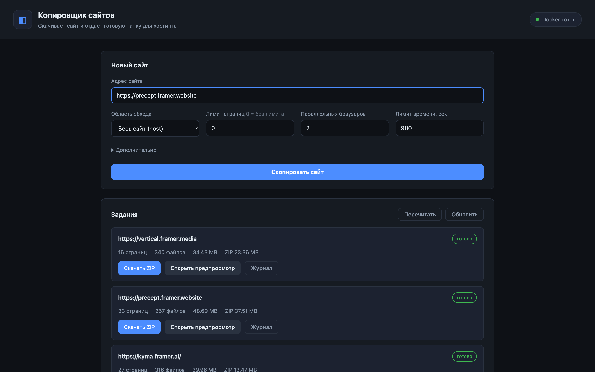
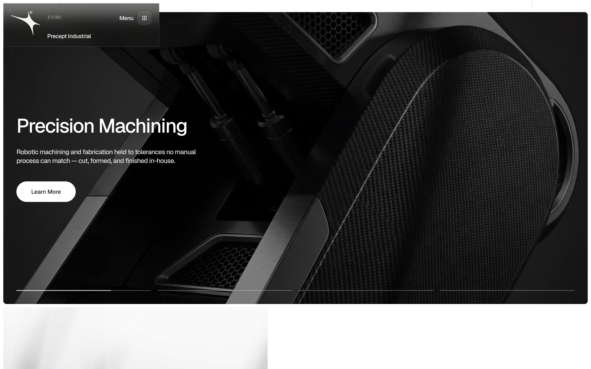
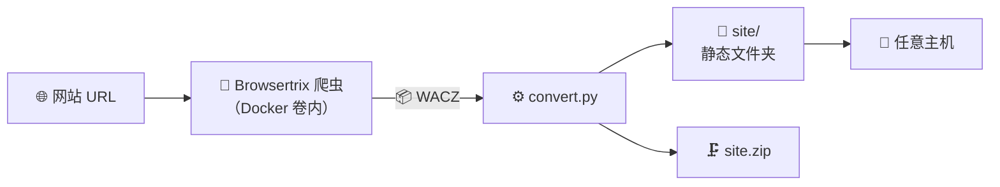

<div align="center">

# ◧ site-copier

**把任意 Framer 网站复制成静态文件夹——可直接部署到任何主机**


[🇷🇺 Русский](README.md) · [🇬🇧 English](README.en.md) · **🇨🇳 中文**

</div>

---

## 📸 界面截图

<details open>
<summary><b>管理面板</b>——新建任务表单与任务列表</summary>
<br>

</details>

<details open>
<summary><b>已完成的任务</b>——状态、统计、ZIP 与预览按钮</summary>
<br>

</details>

<details open>
<summary><b>复制结果</b>——precept.framer.website（33 个页面）的副本完全离线运行</summary>
<br>

<br><br>

</details>

## ✨ 功能特性

| | |
|---|---|
| 🌐 **任意 Framer 网站** | 粘贴 URL——得到可运行的网站文件夹 |
| 🧹 **干净的副本** | Framer 编辑器面板与推广徽章（"Made in Framer"、"Buy template"、"Remix"、"from $99"）全部移除 |
| 🔌 **完全离线** | 零外部请求，所有资源本地化 |
| 🖱 **“活”的副本** | Framer 水合与动画照常工作——不会白屏 |
| 📦 **一键 ZIP** | 可直接上传到任意主机的文件夹 |
| 👀 **内置预览** | 每个副本都能在面板里直接用浏览器打开 |
| 💾 **磁盘满也不怕** | 爬取在 Docker 卷内进行，绕过 99% 磁盘占用阈值 |

## 🚀 快速开始

```bash
# 1. Docker（macOS 推荐 OrbStack——比 Docker Desktop 更轻更快）
brew install orbstack && open -a OrbStack
# Linux: sudo apt install docker.io

# 2. 获取项目
git clone https://github.com/robofighter/site-copier.git
cd site-copier

# 3. Browsertrix 爬虫镜像 —— 必需（详见下方章节）
docker pull webrecorder/browsertrix-crawler:1.15.0

# 4. 启动面板（默认端口 8200，自定义：PORT=9000）
python3 server.py

# 5. 浏览器打开 → http://127.0.0.1:8200
```

其余操作都在面板里完成：**URL → "复制网站" → 等待"完成" → "打开" / "下载 ZIP"**。

> **为什么镜像是必需步骤。** 它不是附加组件，而是**爬虫本体**：没有它系统
> 根本无法工作，任务会以“下载镜像失败”报错。面板会在首个任务时尝试自动拉取
> 镜像（失败时状态徽标显示“镜像未下载”），但最好提前拉好，免得第一个任务
> 干等一个 GB 的下载。

## 🐳 Browsertrix 爬虫镜像 —— 核心依赖

**它是什么。** `webrecorder/browsertrix-crawler:1.15.0` 是
[Browsertrix](https://github.com/webrecorder/browsertrix) 项目（Webrecorder）
的官方容器：内含 Chromium 和在**真实浏览器**中遍历网站的爬虫。每个任务都会
运行它（`crawler.py` → `docker run`），所以 Docker 不是可选项，而是硬性要求。

| 参数 | 值 |
|---|---|
| 镜像 | `webrecorder/browsertrix-crawler:1.15.0` |
| 大小（压缩后） | ~1.03 GB（含层在磁盘上约 3.6 GB） |
| 架构 | arm64（Apple Silicon）/ amd64 —— Docker 自动选择 |
| 用途 | 在浏览器中遍历网站 + 录制 WACZ |
| 缺少它 | 任务报“下载镜像失败”，面板显示“镜像未下载” |

<details open>
<summary><b>下载镜像</b></summary>

```bash
docker pull webrecorder/browsertrix-crawler:1.15.0
```

验证镜像已就位：

```bash
docker images webrecorder/browsertrix-crawler
# 或查看详情：
docker image inspect webrecorder/browsertrix-crawler:1.15.0
```

面板也会自行检查镜像——右上角徽标（“Docker 就绪” / “镜像未下载”）
以及 `GET /api/status`。
</details>

<details>
<summary><b>自动下载</b></summary>

如果任务启动时镜像缺失，`crawler.py` 会自行执行 `docker pull` 并继续工作。
很方便，但首次启动会花上与下载相当的时间——因此建议提前手动
`docker pull`。
</details>

<details>
<summary><b>离线 / 换机器：用归档保存和加载镜像</b></summary>

```bash
# 保存为文件（在有网络的机器上）
docker save webrecorder/browsertrix-crawler:1.15.0 | gzip > browsertrix-crawler.tar.gz

# 从文件加载（在无网络的机器上）
gunzip -c browsertrix-crawler.tar.gz | docker load
```
</details>

<details>
<summary><b>如果 docker pull 失败</b></summary>

- 检查 Docker 是否已运行（`docker info`）以及网络是否可达。
- 处于公司代理环境时，为 Docker 守护进程设置
  `HTTP_PROXY`/`HTTPS_PROXY`（在 OrbStack / Docker Desktop 设置中）。
- 清理磁盘空间：需要约 4 GB。
- 替代方案——从另一台机器拷贝镜像归档（见上文）。
</details>

<details>
<summary><b>部署到服务器 / VPS</b></summary>

```bash
# 在 Linux 服务器上
sudo apt update && sudo apt install -y docker.io python3
sudo usermod -aG docker $USER && newgrp docker
git clone https://github.com/robofighter/site-copier.git && cd site-copier
docker pull webrecorder/browsertrix-crawler:1.15.0   # 爬虫镜像 —— 必需
PORT=8200 nohup python3 server.py > panel.log 2>&1 &
# 面板地址：http://<服务器IP>:8200
```
</details>

<details>
<summary><b>Git：更新项目到最新版本</b></summary>

```bash
cd site-copier
git pull                 # 从 GitHub 拉取更新
docker pull webrecorder/browsertrix-crawler:1.15.0   # 如果镜像标签有变
```

`jobs/`、`previews/`、`crawls/` 目录不受 git 跟踪（见 `.gitignore`）——
`git pull` 不会影响你的任务和已复制的网站。
</details>

## 🧩 工作原理



1. **爬取**（`crawler.py`）——Browsertrix 在真实浏览器中遍历网站，生成 WACZ。
2. **转换**（`convert.py`）——WACZ 变成文件夹：URL 改写为本地路径，向页面注入
   `new URL()` 兼容层（没有它 Framer 水合会失败、页面白屏），切除 Framer 编辑器
   面板，水合完成后由 MutationObserver 清除推广徽章。
3. **完成**——`site/` 原样上传到任意主机，另有 ZIP 供下载。

## 🖥 网页面板

- **新建网站**——URL、爬取范围（host / prefix / domain / page）、页面数量上限、
  并行浏览器数、时间上限、行为选项、自定义 CSS 隐藏选择器
- **任务**——状态与阶段 `queued → crawl → convert → done`，实时日志
- **预览**——每个副本由独立迷你服务器托管，与真实部署一致
  （根绝对路径 `/assets/...` 正常工作）
- **下载 ZIP** · **重新读取**——无需重启面板即可重扫 `jobs/` 目录

## 📦 依赖

| 组件 | 用途 | 必需 |
|---|---|---|
| **Docker**（OrbStack / Docker Desktop / docker-ce） | 在容器中运行爬虫 | ✅ |
| **镜像 `webrecorder/browsertrix-crawler:1.15.0`** | **爬虫本体**——没有它任务无法运行（[详情](#-browsertrix-爬虫镜像--核心依赖)） | ✅ |
| **Python 3.8+** | 面板与转换器 | ✅ |
| pip 包 | **无需安装**——全部代码仅使用标准库 | — |
| Node.js + Playwright | 仅用于副本的自动化浏览器检查（外部脚本） | ⬜ 可选 |

<details>
<summary><b>环境变量</b></summary>

- `PORT`——面板端口（默认 `8200`）
- `BTRIX_IMAGE`——爬虫镜像标签（默认 `webrecorder/browsertrix-crawler:1.15.0`）
</details>

## 🗂 项目结构

```
site-copier/
├── server.py      # 网页面板：任务、状态、ZIP、预览、API
├── crawler.py     # Docker 中的 Browsertrix 爬虫封装（在卷内爬取）
├── convert.py     # WACZ → 静态文件夹（URL 改写、清理）
├── warcutil.py    # WACZ/WARC 解析、记录提取
├── static/        # 面板界面（index.html, app.js, style.css）
├── docs/          # 截图
└── jobs/          # 任务产物（不纳入 git）
```

## 🔌 API

<details>
<summary><b>面板接口</b></summary>

| 方法 | 路径 | 用途 |
|---|---|---|
| GET | `/api/status` | Docker 与镜像状态 |
| GET | `/api/jobs` | 任务列表 |
| POST | `/api/jobs` | 创建任务（`{url, scope, limit, workers, timeLimit, behaviors, hideSelectors}`） |
| GET | `/api/jobs/<id>` | 任务详情 + 日志 |
| GET | `/api/jobs/<id>/download` | 下载 `site.zip` |
| GET | `/api/jobs/<id>/open` | 预览地址 |
| GET | `/api/jobs/<id>/preview/<路径>` | 提供副本文件（正确的 MIME） |
| POST | `/api/jobs/rescan` | 从磁盘重新读取 `jobs/` |
</details>

## 🐛 已知坑点

<details>
<summary><b>爬取开始时提示 "Out of disk space"</b></summary>

问题不在剩余空间，而在**占用百分比**：Browsertrix 内置硬编码阈值
`usedPercentage >= 99`。当主机占用达到 99% 时，即使还剩 15+ GB，爬取也会在几秒内
失败。解决方案已内置：爬取在命名 Docker 卷中进行（OrbStack 虚拟机磁盘占用约
22%），完成后将结果拷回。若无法创建卷，`crawler.py` 会优雅回退到任务目录。
</details>

<details>
<summary><b>全宽模块里的 "Buy Now" 推广徽章</b></summary>

某些模板会把购买控件作为 `data-framer-name="Buy Template Module"` 注入并横跨整个
页面宽度，而内部可见按钮的名称是中性的（`Button Wrapper`）。单纯的尺寸保护会放过
这类模块——现在徽章清扫器还会检查模块内容中的推广特征（`Buy Now`、`from $99`、
结账链接），并隐藏整个模块。
</details>

<details>
<summary><b>HTTP_PROXY / HTTPS_PROXY 环境变量</b></summary>

它们会破坏通过 `curl`（502）和浏览器（`ERR_PROXY_CONNECTION_FAILED`）的手动检查。
对面板本身无影响；手动检查时请使用 `curl --noproxy '*'` 和浏览器的
`--no-proxy-server`。
</details>

## ✅ 已验证网站

| 网站 | 页面数 | 完成 | 水合 | 图片 | 外部 | 404 | 错误 | 推广 |
|---|---|---|---|---|---|---|---|---|
| `precept.framer.website` | 33 | ✅ | Y | 25/25 | 0 | 0 | 0 | 0 |
| `kyma.framer.ai` | 27 | ✅ | Y | 31/31 | 0 | 0 | 0 | 0 |
| `oberon.framer.website` | 8 | ✅ | Y | 36/37 | 0 | 0 | 0 | 0 |

“水合”——Framer 水合已完成（“没有白屏”的关键标志）；“外部”——向第三方服务器的
请求；“推广”——Framer 徽章，包括模板购买按钮。

## 📣 推广

**GitHub 话题标签**——已设置在仓库上，通过这些标签可以在 GitHub 搜索中发现本项目：

`framer` · `framer-website` · `framer-template` · `website-copier` · `site-downloader` · `website-cloner` · `web-archiving` · `browsertrix` · `webrecorder` · `static-site` · `docker` · `python` · `web-crawler` · `web-scraping` · `self-hosted` · `site-backup` · `web-archive` · `offline-first`

**发帖用标签**（X/Twitter、Reddit 等）：

```
#framer #framerwebsite #webdev #python #docker #opensource
#webarchiving #staticwebsite #selfhosted #websitecopier #开源
```

<div align="center">

**面板 · ZIP · 自包含副本——全部本地运行，无需订阅**

</div>
